import teaser from "./Teaser.jpg";

export const meta = {
  teaser,
  category: "후기",
  title: "인터넷 중독자의 스타링크 사용기",
  date: "2026-11-07T16:00:00+09:00",
};

스타링크가 대한민국을 포함한 일부 나라에서 꽤 파격적인 할인 행사를 진행하고 있습니다. 하드웨어와 서비스 요금제를 모두 50% 할인해 주는 행사인데, 거의 거저나 다름없는 식의 행사입니다.

집에 있는 모든 조명이 인터넷에 연결되어 있을 정도로 정말 인터넷을 많이 사용하고, 평소 스타링크에 대한 궁금증도 가지고 있었기 때문에 지나치기 어려웠습니다.

처음에는 공식 홈페이지에서 하드웨어를 구매했다가, 이마트 일부 점포의 일렉트로마트에서도 배송비를 제외한 할인가에 구매할 수 있어서 Standard 4 X, Mini 하나씩 구매했습니다.

# 지나칠 수 없는 할인

---

이 글을 쓰는 기준으로 스타링크 한국 페이지에는 "가정용 및 여행용 Starlink 하드웨어와 서비스 플랜 50% 할인. 혜택은 2026년 11월 28일에 종료됩니다."라는 문구가 걸려 있었습니다.

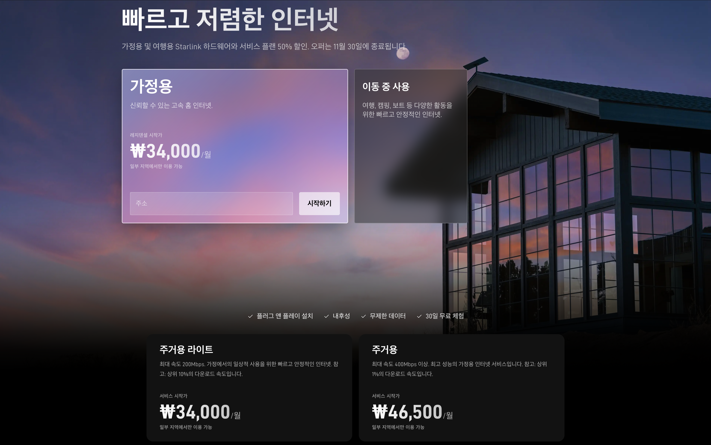

각 서비스 플랜별 정상 요금과 할인 요금은 아래와 같습니다.

| 서비스 플랜 | 정상 요금 (월) | 할인 요금 (월) |
| --- | --- | --- |
| 주거용 라이트 | 68,000원 | 34,000원 |
| 주거용 | 93,000원 | 46,500원 |
| 로밍 100GB | 77,000원 | 38,500원 |
| 로밍 무제한 | 153,000원 | 76,500원 |

스타링크 고객센터의 [프로모션 요금 약관](https://starlink.com/kr/support/article/1c02f831-d9fa-3602-eb59-28af01fb470d)을 보면, 할인 요금은 6개월이나 12개월처럼 정해진 기간에만 적용된다고 명시되어 있습니다. 11월 28일은 할인이 끝나는 날이 아니라, 이 조건으로 가입할 수 있는 마지막 날입니다.

약관에서는 요금제를 바꾸거나 해지하면 할인이 사라진다고 명시되어 있어서 설정을 완료하고 미사용 상태로 서비스를 해지하고 다시 활성화해 보니, 서비스 50% 할인 혜택이 적용된다고 표시되고 있었습니다.

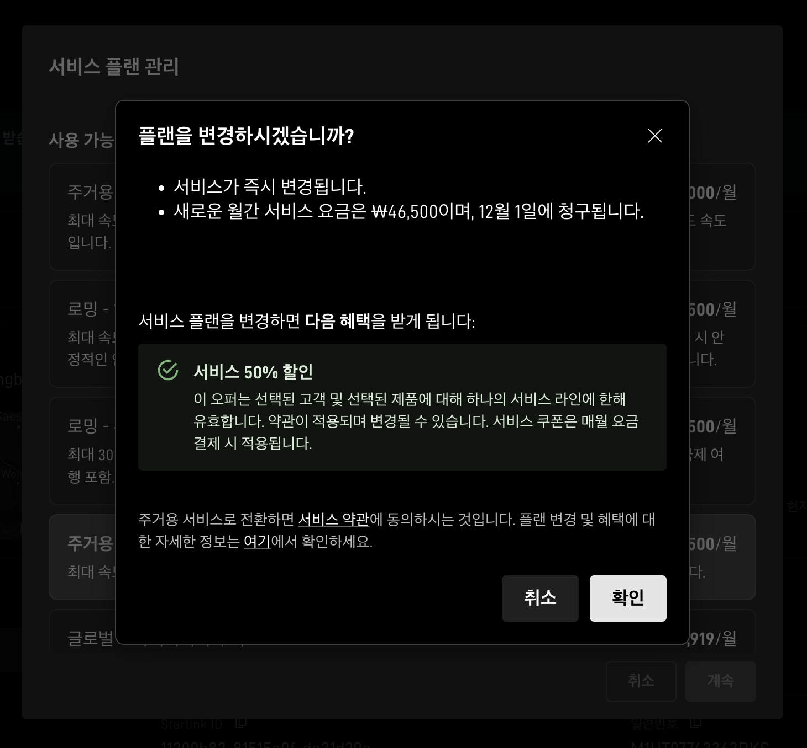

조금 검색해 보니, 할인이 평생이라고 답변받은 분들도 계신 거 보니 약관이 업데이트 전인 것 같다는 생각이 듭니다.

각 하드웨어의 배송비를 포함하지 않은 정상 요금과 할인 요금은 아래와 같습니다.

| 하드웨어 | 정상 요금 | 할인 요금 |
| --- | --- | --- |
| Standard 4 X | 550,000원 | 275,000원 |
| Mini | 320,000원 | 160,000원 |

이마트 일부 점포의 일렉트로마트에서는 배송비 없이 구매할 수 있지만, 스타링크 공식 홈페이지에서 구매할 때 32,000원의 배송비가 부과됩니다.

다만, 공식 판매점에서 산 키트에는 한 가지 아쉬운 점이 있습니다. 스타링크 고객센터의 [추천 프로그램 안내](https://starlink.com/kr/support/article/eee7e99e-a736-f16e-9506-c446dd70fb16)를 보면, 추천 보상은 [starlink.com](https://starlink.com/)에서 주문할 때만 주어지고, 판매 대리점이나 매장에서 산 키트는 대상이 아니어서 추천 보상을 챙기고 싶으시면 홈페이지에서 주문하시는 게 좋습니다.

# 한국에서 스타링크가 필요할까?

---

대한민국에서는 스타링크가 아주 매력적인 선택지는 아닙니다. 하드웨어 가격은 꽤 비싸고, 대부분의 주거지에서는 스타링크보다 더 빠르고 안정적인 인터넷을 더 저렴한 가격에 사용할 수 있기 때문입니다.

저는 단순 호기심도 있었고, 가끔 통신 상황이 좋지 못한 해외에 갈 때도 있고, 국내에서도 유선 인터넷을 끌어오는 것이 현실적이지 않은 곳에 머물 때가 있었기 때문에 구매하였습니다.

국내에서 개인이 살 수 있는 스타링크 하드웨어는 크게 [Mini](https://starlink.com/kr/specifications/5)와 [Standard](https://starlink.com/kr/specifications/4) 두 가지입니다.

## 가볍게 들고 다니는 Mini

스타링크 Mini에는 Wi-Fi 라우터가 통합되어 있는 본품과 킥스탠드, 미니 파이프 어댑터 및 플랫 마운트, DC 전원 케이블 15m, 전원 어댑터, 사용 설명서가 들어 있습니다.

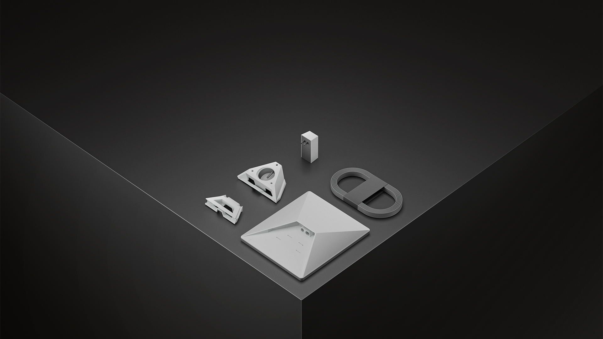

Mini는 이름처럼 작습니다. 라우터가 본체에 들어 있어서 따로 챙길 장비가 없고, 전력 소비가 낮은 데다 DC 전원을 받을 수 있어 보조배터리나 차량 전원으로도 쓸 수 있습니다. 다운로드 속도는 스타링크 홈페이지 기준 최대 200Mbps 이상입니다.

## 정품 USB-C 케이블은 어디에?

Mini를 보조배터리로 쓰려면 USB-C 케이블이 필요한데, 여기서 예상하지 못한 문제가 하나 있었습니다. 정품 USB-C 케이블은 단품 판매가 사실상 끝나고 'Mini Car Adapter' 키트에 함께 들어 있는 형태로 바뀌었는데, 한국 스타링크 스토어에서는 이 차량용 어댑터조차 찾을 수 없었습니다.

결국 서드파티 케이블을 쓰기로 했습니다. 근데, 이것도 국내에서 구하기는 매우 어려워서 일본 아마존에서 직배송해 주는 상품을 구매했습니다.

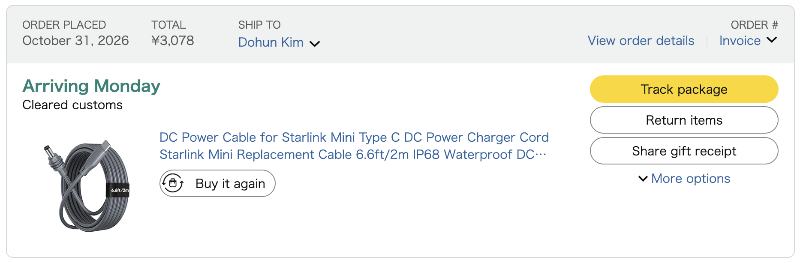

## 한 자리를 지키는 Standard

Standard에는 본품과 킥스탠드, Wi-Fi 라우터, 스타링크 케이블, AC 케이블, 전원 어댑터, 사용 설명서가 들어 있습니다.

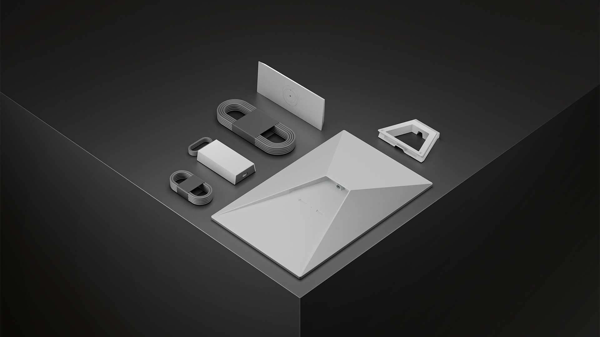

Mini와 가장 큰 차이는 라우터가 따로 있다는 점입니다. 안테나는 하늘이 보이는 바깥에 두고, 라우터는 실내에 둘 수 있습니다. 최대 속도도 홈페이지 기준 400Mbps 이상으로 Mini보다 빠릅니다.

공식 'Standard Pipe Adapter'를 쓰면 지름 31~63.5mm의 금속 파이프에 고정할 수 있어서, 주택이나 농막에 붙박이로 달기에는 Standard가 알맞습니다.

## 그래서 뭘 사야 하지?

| 구분 | Mini | Standard |
| --- | --- | --- |
| 라우터 | 본체에 내장 | 별도 |
| 전원 | DC 입력, 낮은 전력 소비 | 전원 공급 장치(AC) |
| 최대 속도 | 200Mbps 이상 | 400Mbps 이상 |
| 어울리는 곳 | 캠핑, 차박처럼 옮겨 다니는 곳 | 주택, 농막처럼 한곳에 고정하는 곳 |

들고 다니며 여러 곳에서 쓸 생각이라면 Mini가, 한곳에 달아 두고 오래 쓸 생각이라면 Standard가 맞습니다. 일단 너무 매력적인 가격에 두 하드웨어 모두 구매했지만, 들고 다니며 여러 곳에서 Mini를 많이 사용할 것 같습니다.

# 복잡하지 않은 활성화

---

저는 공식 판매 대리점(일렉트로마트)에서 구매했기 때문에 스타링크 공식 홈페이지에서 사용할 주소를 적고 시작하기를 눌러 나온 화면에서 화면을 아래로 내려서 '이미 Starlink 키트를 보유하고 계시나요? 여기를 클릭하세요.'를 눌렀습니다. 매장에서 산 하드웨어는 홈페이지에서 새로 주문하는 대신, 이렇게 이미 가진 하드웨어를 등록하는 방식으로 시작합니다.

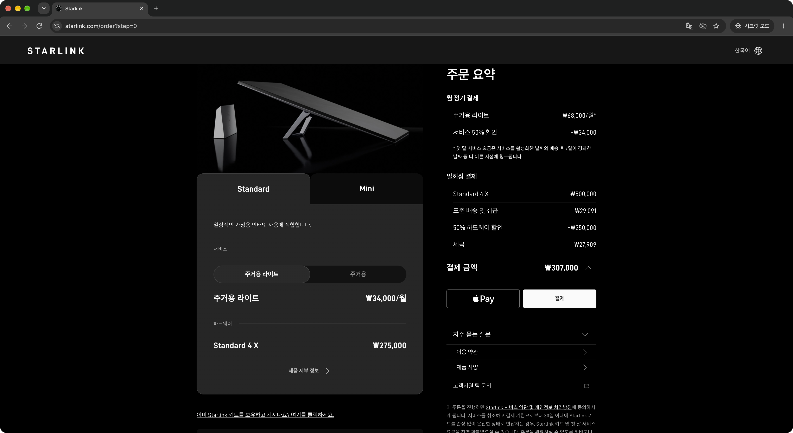

다음 화면에서는 키트의 식별 번호를 입력합니다. 상자 라벨에 적힌 'KIT'로 시작하는 일련번호를 입력해야 합니다. 본체에 S/N이라고 표기되어 있는 부분은 'KIT'로 시작하지 않았고, 입력해도 다음 단계로 진행할 수 없었습니다.

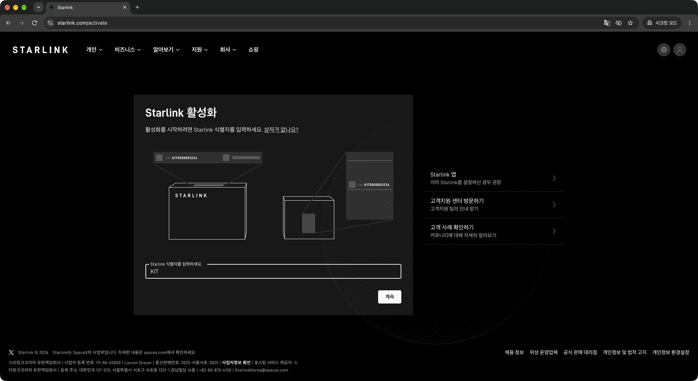

이후에는 제 이메일 주소와 이름, 전화번호를 입력하였습니다. 이 과정은 스타링크 계정을 생성하는 데 필요한 것으로 보이며, 만약 스타링크 계정이 이미 있다면, 하단의 로그인 버튼을 통해 로그인할 수 있는 것으로 보입니다.

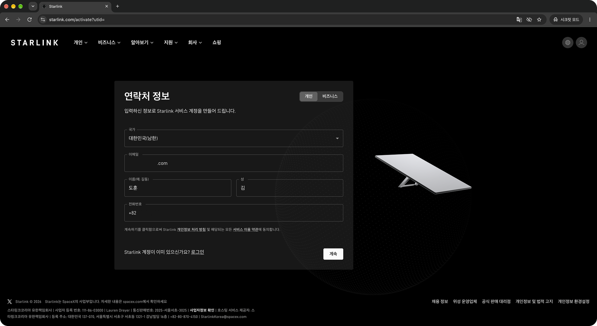

또 서비스 주소를 입력하는 단계가 나왔습니다. 첫 화면에서 서비스 주소를 입력해서 다시 안 물어볼 줄 알았는데, 또 물어보는 부분은 꽤 의아했습니다.

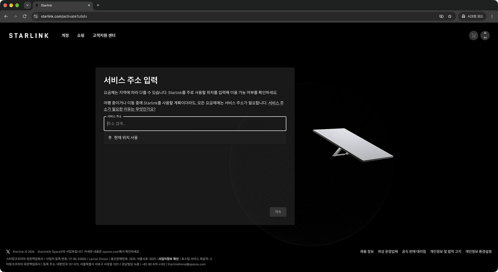

그다음은 개인용, 비즈니스 서비스를 선택하고 그중 제공되는 서비스 플랜을 선택하는 화면이 나왔습니다. 활성화 후, 비즈니스 서비스 플랜으로 변경할 수 있던데, 사용 불가라고 나오는 부분은 의아했습니다.

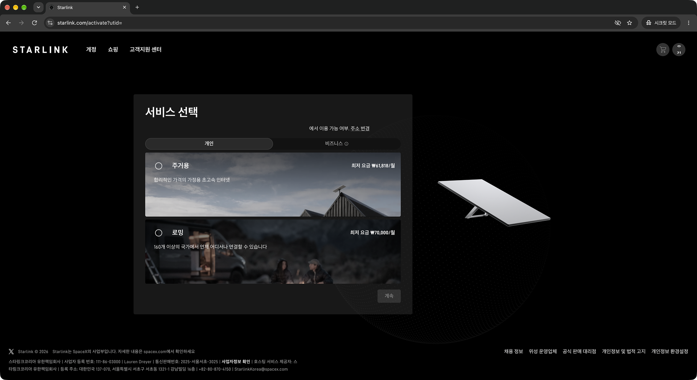

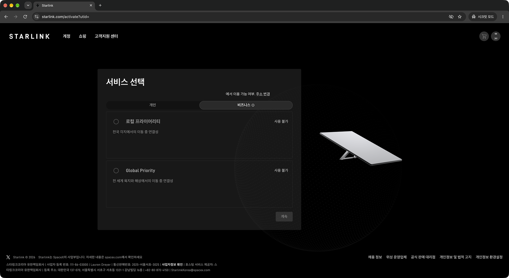

일단 주거용 서비스로 진행하면, 주거용 라이트와 주거용 중 고를 수 있습니다. 두 서비스 플랜의 차이는 속도입니다. 주거용이 주거용 라이트에 비해 2배 빠른데, 가격 차이가 크게 나지 않으니, 주거용을 선택하시는 것을 추천해 드립니다. 이 화면에서 50% 할인가로 표시가 안 되는데, 다음 화면에서는 할인가로 표시됩니다.

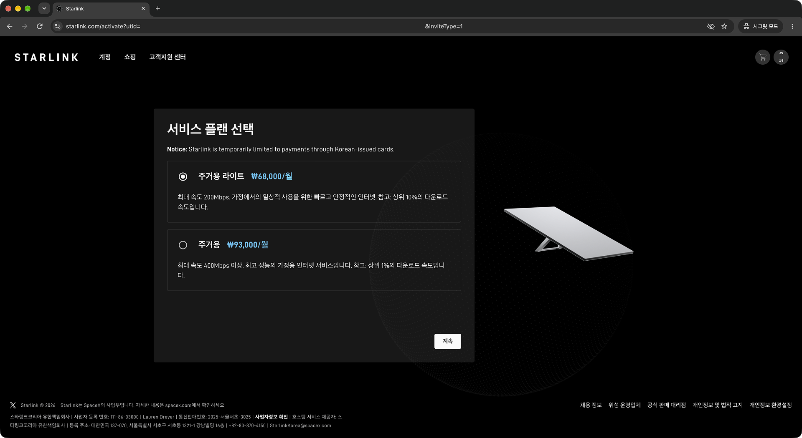

이제 계정 주소와 매달 서비스 플랜이 결제될 카드 정보를 채우고 저장하면 50% 할인가가 적용된 서비스 플랜 이용 요금이 결제되고 활성화가 완료됩니다.

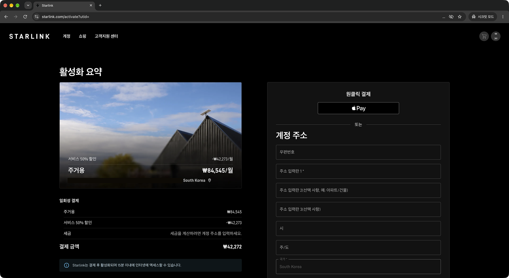

이 이후에는 스타링크 앱에 로그인해서 안테나 상태를 볼 수 있습니다. 홈페이지에서 활성화하는 데 3분 남짓 걸린 것 같습니다. 공식 판매점에서 구매하여서 키트를 기다릴 필요 없이 바로 활성화가 가능한 점도 좋았습니다.

또한, 대한민국에서는 인터넷을 가입하려면 설치 가능 여부 확인, 본인 인증, 카드 등록, 방문 설치, 장비 설정까지 꽤 긴 시간이 걸리는데, 활성화도 스스로 가능하고 설치도 원할 때 스스로 하면 되는 점이 매우 마음에 듭니다.

# 드디어 밖으로

---

애초에 밖에서 쓰려고 산 Mini라서, 첫 시험도 밖에서 해 보기로 했습니다. 아파트 같은 환경에서는 제대로 사용이 어렵기도 합니다.

일본 아마존에서 사 온 USB-C 케이블과 보조배터리를 챙겨서 근처 공원으로 나갔습니다. 전원을 연결하니 후면에 파란 불빛이 들어옵니다.

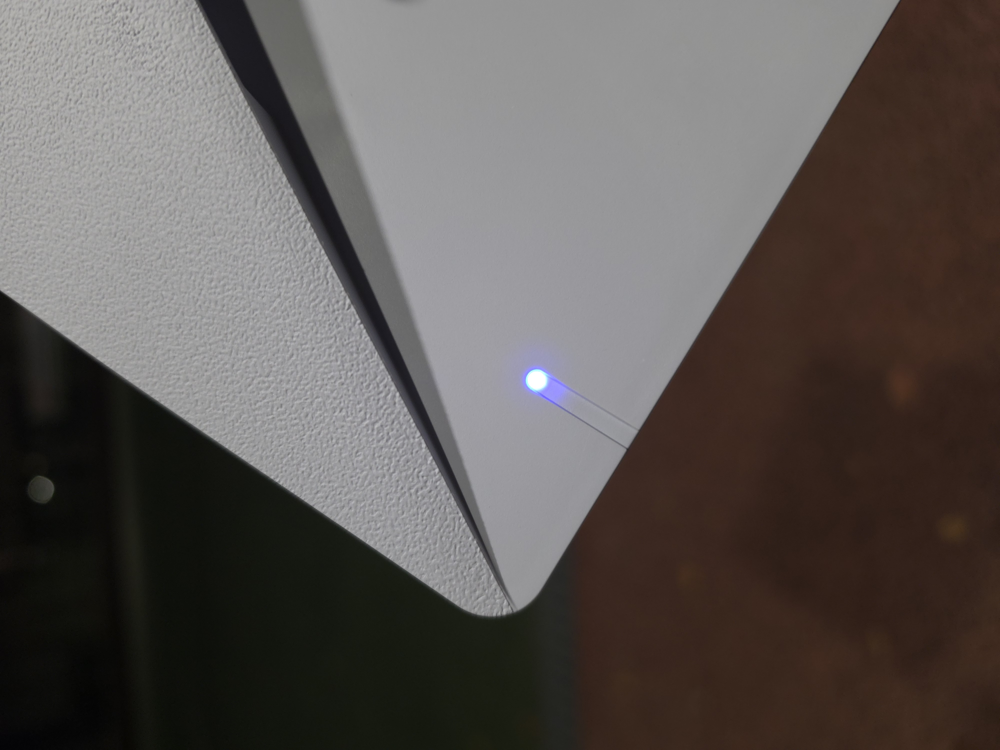

## 야외 설치도 간단하다!

스타링크 Mini는 USB PD로 전원 공급 시에 20V 5A(100W)를 요구하기 때문에, 보조배터리도 100W PD 출력을 지원해야 합니다. 출력이 부족하면 전원이 아예 들어오지 않거나 사용 중에 끊길 수 있습니다. 저는 앤커 프라임 26250mAh 300W 보조배터리를 사용했습니다.

킥스탠드를 펴서 하늘이 잘 보이는 곳에 두고 전원을 연결하니, 금방 인터넷에 연결되었습니다. 다만 앱 메인 화면에는 안테나 방향이 어긋나 있다는 안내가 떠 있었습니다.

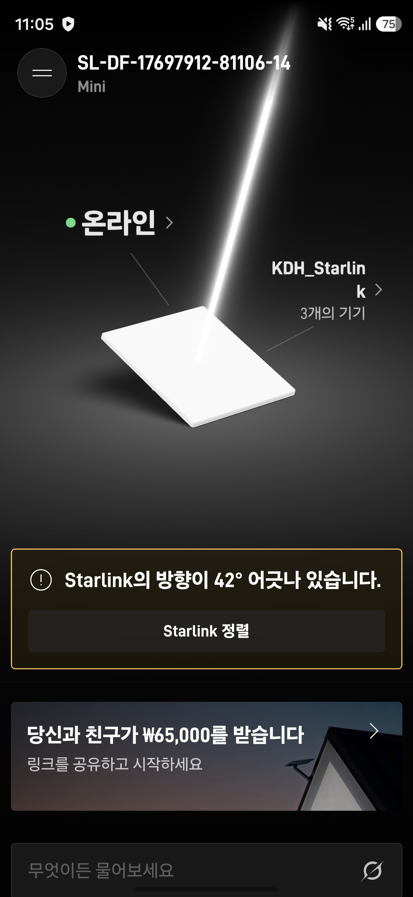

정렬 안내가 신기했던 부분은 스타링크 하드웨어가 바라보는 방향만 인식하는 것이 아니라 스타링크 하드웨어의 각도까지 인식한다는 점이었습니다.

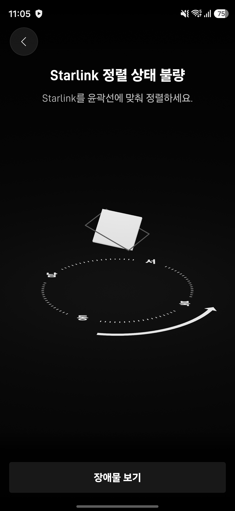

## 얼마나 빠를까?

스마트폰을 Mini의 Wi-Fi에 연결하고 [WiFiman.com](https://wifiman.com/)을 통해 속도를 측정해 보았습니다.

| 측정 | 다운로드 | 업로드 | 지연 시간 |
| --- | --- | --- | --- |
| 1회차 | 293.8Mbps | 18.6Mbps | 103ms |
| 2회차 | 268.4Mbps | 19.3Mbps | 96ms |
| 3회차 | 232.8Mbps | 14.8Mbps | 68ms |

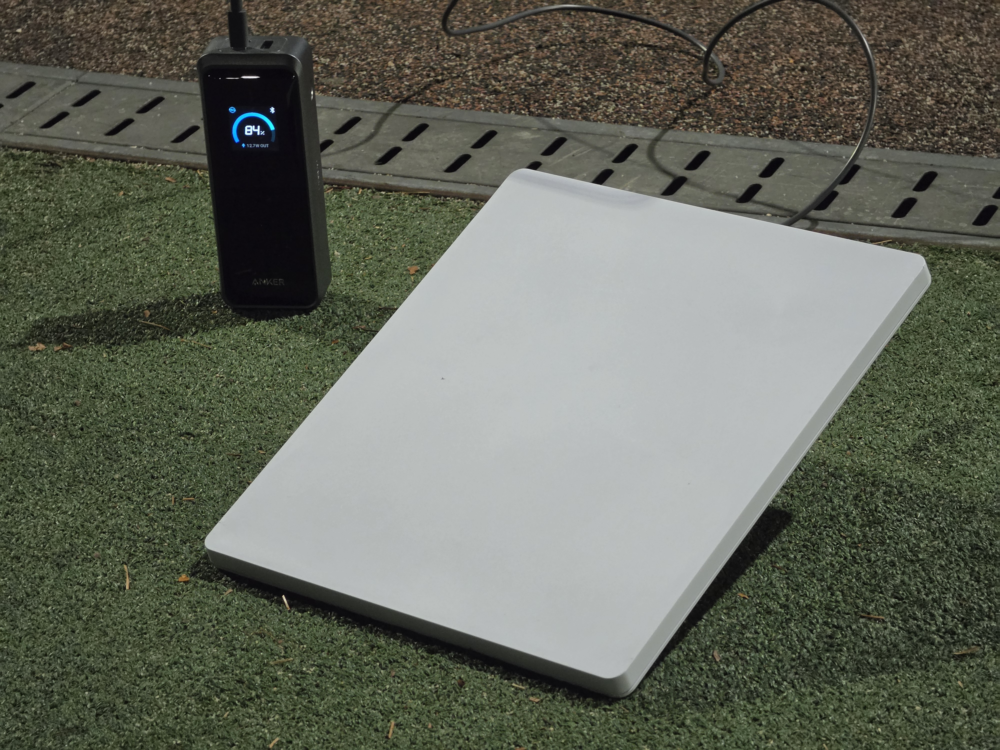

스타링크는 지상에서 약 550km 떨어진 저궤도 위성을 사용해 인터넷을 제공하고, 지상국이 먼 곳에서는 위성끼리 레이저로 데이터를 주고받기도 합니다.

대한항공 항공기에서 비슷한 인터넷 서비스를 사용해 보았을 때 속도 측정이 불가능할 정도로 느려서 기대가 없었는데 깜짝 놀랐습니다.

5G 속도를 한 번 측정 했을 때 다운로드 812.4Mbps, 업로드 93.3Mbps, 지연 시간 28ms로 압도적으로 빨랐습니다. LTE 속도를 한 번 측정 했을 때 다운로드 290.4Mbps, 업로드 53.3Mbps, 지연 시간 43ms로 비슷한 결과를 보여줬습니다.

5G보다는 느리고 LTE와는 비슷한 결과를 보여주는데, 저는 가끔 특정 통신사는 통신이 불가능한 곳에 머물기도 하므로 충분히 의미 있는 결과였습니다.

속도 측정만으로는 실제로 쓸 만한지 알기 어려워서, 평소처럼 디스코드 음성 통화와 화면 공유도 해 보았습니다.

음성 통화는 비트레이트 128kbps로 설정된 통화 방에서 상대방 말을 듣는 것과 상대방에게 들리는 것 모두 문제없었으며, 핑은 60~70ms 정도로 안정적이었습니다.

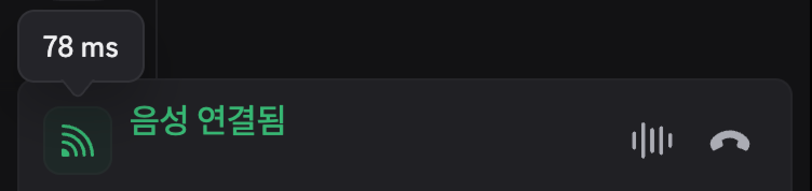

화면 공유는 720p 60FPS 환경에서 시청하는 것과 송출하는 것 모두 문제없이 잘 작동했습니다.

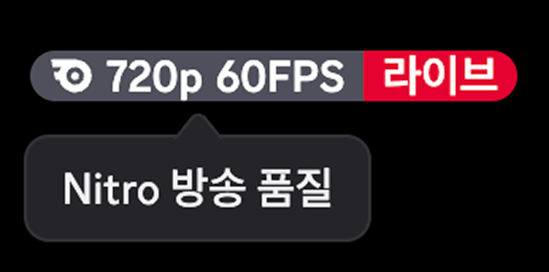

## 배터리는 얼마나 버틸까?

스타링크 Mini는 처음 켜질 때 전력을 많이 쓴다고 알고 있었습니다. 저는 초기 Wi-Fi 설정과 펌웨어 업데이트 때문에 재부팅을 여러 번 했고, 그 과정을 포함해 약 1시간 동안 사용했는데도 보조배터리는 81%가 남아 있었습니다.

1시간에 19%를 쓴 셈이니, 같은 속도라면 남은 81%로 4시간 정도를 더 쓸 수 있습니다. 보조배터리 하나로 5시간 안팎을 버틸 수 있다는 계산입니다. 이 보조배터리의 용량이 약 99Wh이니, Mini가 평균 19W 정도를 썼다고 볼 수 있습니다.

물론 단순 계산이라 실제로는 더 짧을 수 있습니다. 영상을 계속 보거나, 날씨가 덥거나 추워서 Mini가 열을 식히거나 눈을 녹이는 데 전력을 쓰면 소비 전력이 올라갑니다. 그래도 공원에서 반나절 정도 인터넷을 쓰기에는 충분하다고 느꼈습니다.

# 인터넷 중독자의 결론

---

할인 행사에 혹해서 시작했지만, 생각보다 많은 것을 알게 되었습니다. 한곳에 고정해 두고 오래 쓸 곳이 있다면 Standard가, 들고 다니며 필요할 때 펼칠 생각이라면 Mini가 맞습니다.

활성화는 3분 남짓이면 끝날 만큼 간단했고, 공원에서도 보조배터리 하나로 200Mbps 이상의 다운로드 속도를 확인할 수 있었습니다.

다만 스타링크는 장애물이 적고 하늘이 트인 곳이어야 제대로 쓸 수 있습니다. 그래도 스타링크가 필요한 곳은 대부분 유선 인터넷이 닿지 않는 탁 트인 곳일 테니, 큰 문제는 아니라고 생각합니다.

작동할지 걱정되신다면, 사기 전에 스타링크 앱의 장애물 확인 도구로 쓰실 곳의 하늘부터 확인해 보시길 권합니다. 공식 홈페이지에서 구매하셨다면 30일 안에 해지하고 반품해 전액 환불을 받을 수도 있습니다.

집에 있는 모든 조명까지 인터넷에 연결해 둔 인터넷 중독자에게, 가방 속 Mini 하나는 어디서든 인터넷을 펼칠 수 있는 든든한 보험이 되었습니다.